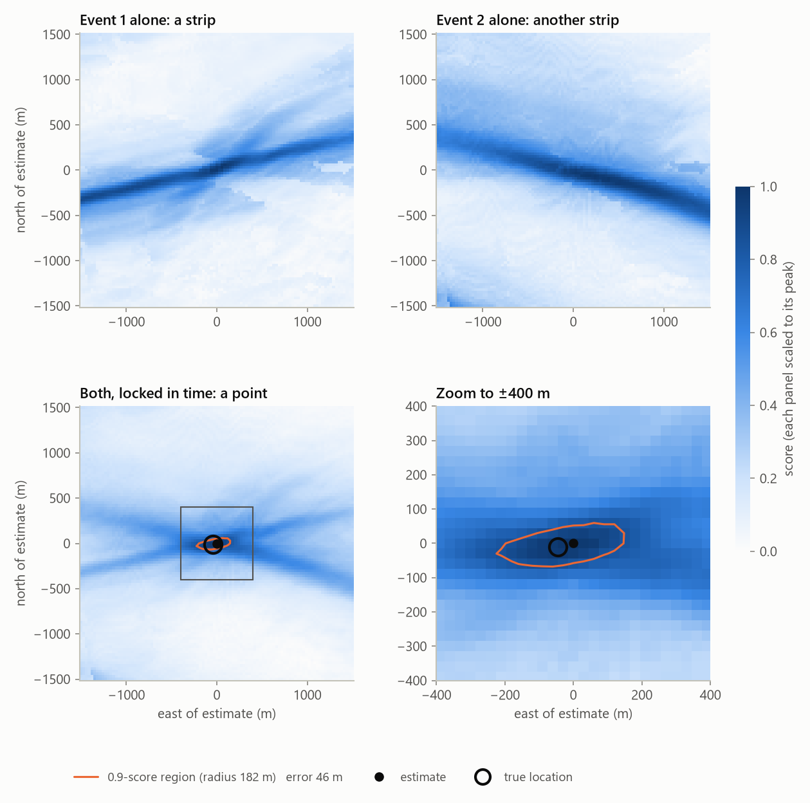
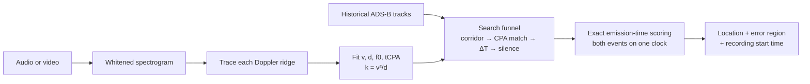
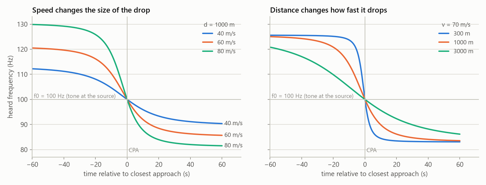
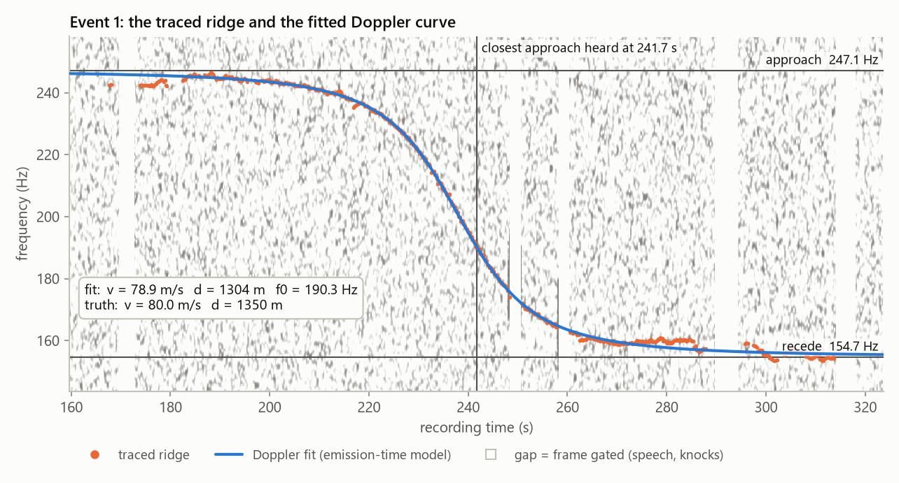
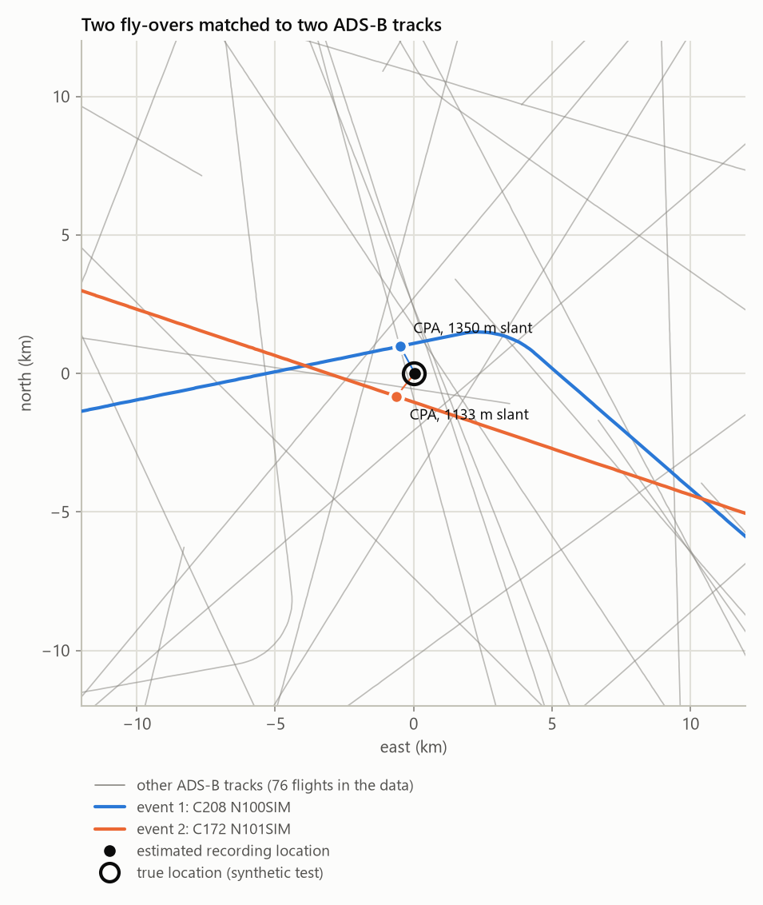

# Audio Fly-over Geolocation

**English** | [简体中文](README.zh-CN.md)

[](https://github.com/AlanBacker/audio-flyover-geolocation/actions/workflows/ci.yml)
[](LICENSE)

An agent skill that works out where an audio or video recording was made from the faint propeller aircraft in
its background. It ships a complete, tested Python pipeline and comes in English and Simplified Chinese.

Small aircraft give off a steady tone. As one flies past, the Doppler effect bends that tone into a falling
curve, and the shape of the curve gives the aircraft's speed, its closest distance to the microphone and the
second it was closest. Public ADS-B archives record where every transponder-equipped aircraft was at every
second. If you search those tracks for the place where the predicted curve matches what was recorded, you find
the microphone. Two fly-overs in one recording are enough, even when the recording time is unknown, because
their time difference is fixed by the recording itself.

The method comes from colsto's video
[*I discovered a sound that leaks your exact location*](https://www.youtube.com/watch?v=UytYrhYLOKI)
(2026-11-02). colsto did not release code; this repository is an independent implementation with no affiliation.

<picture>
  <source media="(prefers-color-scheme: dark)" srcset="docs/images/score-heatmap-dark.png">
  
</picture>

*Synthetic blind test (seed 23): each fly-over alone gives a strip of possible locations. Scored together on one
shared clock, they give a point 46 m from the true recording location, inside the 0.9-score region the pipeline
reports (radius 182 m).*

## Contents

- [How it works](#how-it-works)
- [Accuracy on synthetic blind tests](#accuracy-on-synthetic-blind-tests)
- [Install](#install)
- [Use](#use)
- [Check your own videos](#check-your-own-videos)
- [Limitations](#limitations)
- [Responsible use](#responsible-use)
- [Repository layout and development](#repository-layout-and-development)
- [Credits and sources](#credits-and-sources)

## How it works



**1. Read the curve.** The heard frequency is `f = f0 / (1 + Ṙ/c)`, where Ṙ is the aircraft's range rate at
the moment the sound was *emitted*. The two flat ends of the curve give the speed
(`v = c·(f_hi − f_lo)/(f_hi + f_lo)`). The steepness at closest approach gives the distance
(`d = f0·v²/(c·|slope|)`).

<picture>
  <source media="(prefers-color-scheme: dark)" srcset="docs/images/doppler-curves-dark.png">
  
</picture>

**2. Trace it out of the noise.** The spectrogram is whitened against a running median background, and
frames with speech or knocks are gated out. A monotone Viterbi path is then accepted only if it beats a null
path computed on time-shuffled frames, so the tracer does not hallucinate curves in pure noise. When the flat
ends are faint, v and d trade off against each other, but `k = v²/d` stays well determined. The search
therefore checks every candidate aircraft against k computed from its own ADS-B ground speed.

<picture>
  <source media="(prefers-color-scheme: dark)" srcset="docs/images/spectrogram-fit-dark.png">
  
</picture>

**3. Search the ADS-B archive.** The search runs on a 200 m grid with 3D slant distances in ECEF and DEM
ground elevation, and narrows the candidates in stages:
1. corridors around tracks that fit the aircraft class and speed;
2. a closest-point-of-approach match that includes the sound's travel time;
3. the time offset between the two fly-overs;
4. a silence check: no other aircraft may have passed close while the recording was quiet.

<picture>
  <source media="(prefers-color-scheme: dark)" srcset="docs/images/search-map-dark.png">
  
</picture>

**4. Score against the exact physics.** For each surviving candidate, the curve is predicted from the
aircraft's real track by emission time, and the spectrogram is sampled along it. Both events share one clock
offset, which keeps the strongest constraint: the purely physical time difference between them. A shrinking
hill-climb refines the best points to 25 m. A fine heat map gives the reported error region. Degenerate
geometry is always reported, never hidden:
- straight single passes have a mirror twin;
- a loose clock leaves an along-track strip;
- near-parallel tracks leave a strip.

## Accuracy on synthetic blind tests

`selftest` simulates a 50–70 km area over 4 hours with about 70 flights (45 propeller, 25 jet). It adds a
~24-minute recording with two fly-overs plus pink noise, mains hum, speech and jet noise. Event 2's aircraft
accelerates before its closest approach and climbs after it, on purpose, so the simple fit is biased. The
pipeline then runs blind, and the result is compared with the hidden truth. CI runs all six seeds on every push.

| Seed | Two events, clock unknown | One event, clock ±2 s, turning pass | One event, clock ±2 s, straight pass | One event, clock ±30 s |
|---|---|---|---|---|
| 7 | 24 m | 23 m | mirror; truth is the flagged alternative | truth inside the reported strip |
| 11 | 477 m, flagged (tracks cross at 3°); truth inside the reported 849 m region | 35 m | mirror; truth is the flagged alternative | truth inside the reported strip |
| 23 | 46 m | 79 m | 162 m | truth inside the reported strip |
| 42 | 31 m | 86 m | 206 m | truth inside the reported strip |
| 101 | 53 m | 48 m | 213 m | truth inside the reported strip |
| 2026 | 25 m | 96 m | 6 m | truth inside the reported strip |

With a ±30 s clock the strips are 2.1–4.8 km long. Each run takes 45–55 s on one CPU core.

These numbers are for idealised data: no ADS-B gaps, no wind, no multipath. Expect larger errors on real
footage. What the test does establish is that the pipeline is correct and that its stated uncertainty is
honest.

## Install

The two language editions are the same skill (`audio-flyover-geolocation`) with the same scripts; install one.
It needs Python 3 with `numpy`, `scipy` and `matplotlib` (CI tests Python 3.13). `ffmpeg` is needed for video and compressed
audio, and `rasterio` (optional) for DEM GeoTIFFs.

**Claude Code**
```bash
git clone https://github.com/AlanBacker/audio-flyover-geolocation
```
```bash
cp -r audio-flyover-geolocation/skills/en/audio-flyover-geolocation ~/.claude/skills/
```
```bash
pip install numpy scipy matplotlib
```
For the Chinese edition, copy `skills/zh-CN/audio-flyover-geolocation` instead.

**Claude apps.** Download `audio-flyover-geolocation-en.skill` or `audio-flyover-geolocation-zh-CN.skill` from
[Releases](https://github.com/AlanBacker/audio-flyover-geolocation/releases), then upload it in the Skills
section of the app's settings. Code execution must be turned on.

**Without an agent.** The pipeline is a plain CLI:
```bash
python skills/en/audio-flyover-geolocation/scripts/afg_cli.py -h
```

## Use

Ask in plain language, for example:
- "Where was this video recorded? `clip.mp4`, filmed sometime on 12 October in eastern Kansas."
- "Can you verify this footage was shot near the airfield it claims to be?"
- "Before I post this vlog, check whether its background audio gives away my location."

The skill leads the agent through the steps below:
- inspect the spectrogram and trace each fly-over;
- download only the ADS-B data it needs (adsb.lol, ADS-B Exchange samples or OpenSky);
- search and score;
- check the overlays and heat map;
- grade its confidence;
- write a report that lists every ambiguity.

To see the whole chain on synthetic data:
```bash
python skills/en/audio-flyover-geolocation/scripts/afg_cli.py selftest --seed 23
```
```bash
bash examples/synthetic_demo.sh work/demo 23
```
The demo runs the same CLI commands you would use on real footage:
`simulate → spectrogram → detect → trace → fit → adsb-ingest → search → score`.

Other modes:
- `thunder`: kilometre-level localisation from thunder plus lightning-strike data.
- `audit`: a privacy self-check for your own media.

## Check your own videos

Most masking does not work. A high-pass filter, music over the top, or a phone-call codec all leave the narrow
tones recoverable. What works is removing the information: cut the fly-over out, change the time between two
fly-overs, or replace the audio track. Run `afg_cli.py audit my.mp4 --out work/audit` before posting. A risk of
`undetermined` means the automatic check could not decide (for example a clip shorter than 12 s); it is not a
pass. The skill's [countermeasures reference](skills/en/audio-flyover-geolocation/references/countermeasures.md)
explains why each measure works or fails.

## Limitations

- **Coverage.** It only works where the aircraft is in ADS-B data. Low-level GA outside rule airspace, military
  aircraft and privacy-addressed aircraft can be missing. No match in the data does not mean no match in
  reality. When one of two aircraft is missing, the best score lands somewhere wrong. `score` checks every
  answer against the traced curves and says `NO CONSISTENT SITE` when none fits, but it cannot tell a missing
  aircraft from recordings made at different places.
- **Datums.** Altitude datums matter at close range: pressure altitude needs a QNH correction, and GNSS
  altitude needs a geoid correction.
- **Sound speed.** Its uncertainty scales v and d; strong wind skews the two sides of the curve.
- **Geometry.**
  - A single straight pass has a mirror solution.
  - A single pass with a loose clock gives a strip, not a point.
  - A single pass over a large area fits many aircraft about equally well (`DEGENERATE`); it needs a small
    area as well as a clock.
  - Two nearly parallel tracks also give a strip.

  The pipeline reports each of these, but cannot remove them.
- **Footage.** Editing that changes the time between events breaks the two-event method; a speed change
  rescales everything.
- **Short clips.** A clip under about 2 minutes has too few windows for a background of its own, so `detect`
  compares it with a calibrated noise model and reports `status: limited`. A clip shorter than `--min-dur`
  (15 s; 12 s in `audit`) cannot produce an event and is reported as `insufficient`, never as "nothing found".
- **Overlapping passes.** `detect` separates passes divided by a quiet gap or by a rise in frequency. Two
  aircraft audible at the same time can still end up in one box. Such a box carries a warning when its ridge
  rises again or falls further than one pass can, and `audit` counts it as two. Rising tones are never counted
  as fly-overs.

## Responsible use

This is an OSINT and research tool. Use it to:
- verify where public footage was filmed;
- teach how sound leaks location;
- solve CTFs;
- audit your own media before posting.

Do not use it to locate, follow or expose private individuals without their consent. Follow the terms of each
data source (adsb.lol is ODbL; ADS-B Exchange and OpenSky have their own terms). A result is a hypothesis with
an error bar, not proof: the skill requires independent corroboration before rating anything high-confidence.

## Repository layout and development

```
skills/
  en/audio-flyover-geolocation/      English edition; holds the canonical scripts/
  zh-CN/audio-flyover-geolocation/   Chinese edition; scripts/ is a synced copy
    SKILL.md                         workflow the agent follows
    references/                      physics, spectrogram, ADS-B, search, verification, thunder, privacy, sources
    assets/report_template.md
    scripts/afg_cli.py, scripts/afg/ pipeline (numpy/scipy/matplotlib)
tools/build.py                       check | sync | package
tools/make_figures.py                redraws docs/images from a pipeline run
examples/synthetic_demo.sh           end-to-end CLI run on synthetic data
tests/test_detection.py              detection and audit regression tests (synthetic)
```

- `python tools/build.py check` validates both editions: frontmatter, file references, no Chinese text in the
  English edition, byte-identical scripts.
- Make code changes in `skills/en/.../scripts`, then run `python tools/build.py sync`.
- `python tools/build.py package` writes both `.skill` files to `dist/`.
- Pushing a `v*` tag attaches them to a GitHub release.
- After changing the pipeline, rerun the six-seed self-test and `python -m unittest discover -s tests`
  (CI runs both).

## Credits and sources

- Method: colsto, [*I discovered a sound that leaks your exact location*](https://www.youtube.com/watch?v=UytYrhYLOKI)
  (full recording: <https://youtu.be/4CxVxuMVkMc>).
- Thunder method: colsto, [thunder geolocation](https://www.youtube.com/watch?v=SnbkIm56TfI) and
  [follow-up](https://www.youtube.com/watch?v=6a7Z0I3LAnE).
- Background: B. G. Ferguson, "A ground-based narrow-band passive acoustic technique for estimating the altitude
  and speed of a propeller-driven aircraft," *J. Acoust. Soc. Am.* 92(3), 1403–1407 (1992).
- Data and formats:
  - [readsb trace format](https://github.com/wiedehopf/readsb/blob/dev/README-json.md)
  - [tar1090-db](https://github.com/wiedehopf/tar1090-db) type table (ICAO Doc 8643)
  - [adsb.lol globe_history](https://github.com/adsblol/globe_history_2026)
  - [ADS-B Exchange samples](https://www.adsbexchange.com/data-products/sample-data/)
  - OpenSky Network
  - [Copernicus DEM GLO-30](https://copernicus-dem-30m.s3.amazonaws.com/)
- Coverage: [TechRadar](https://www.techradar.com/computing/cyber-security/youtuber-discovers-aircraft-noise-trick-that-can-geolocate-your-videos-to-within-100m-doppler-effect-pinpoints-locations-from-just-60-seconds-of-audio),
  [Simon Willison](https://simonwillison.net/2026/Nov/3/a-sound-that-leaks-your-exact-location/).

The full list is in [references/sources.md](skills/en/audio-flyover-geolocation/references/sources.md).

## License

[MIT](LICENSE). Data you download through the pipeline stays under its own licence.
