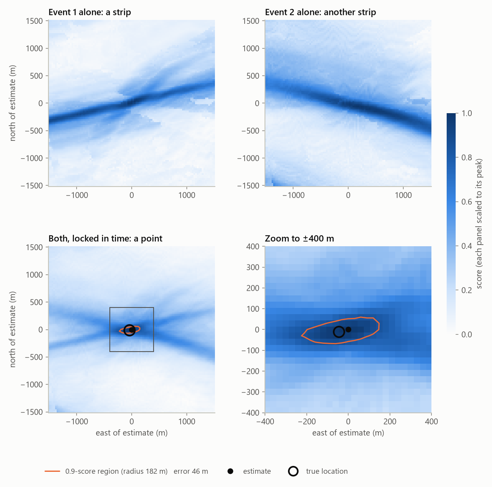
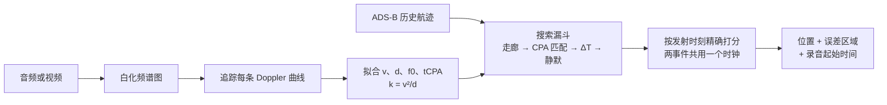
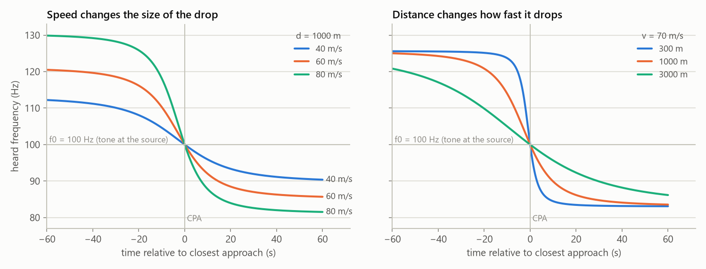
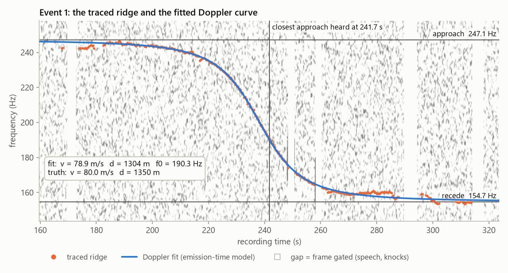
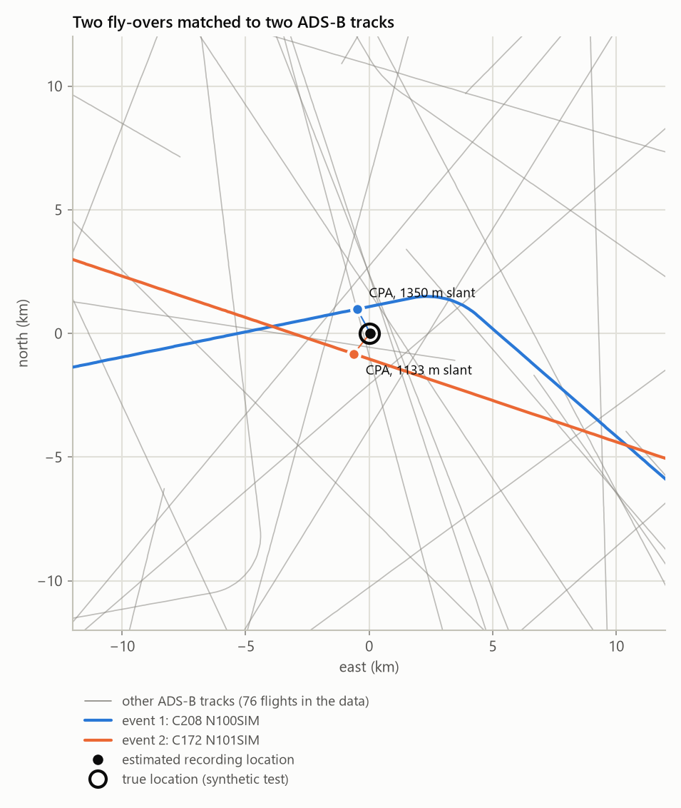

# 声学飞越定位（Audio Fly-over Geolocation）

[English](README.md) | **简体中文**

[](https://github.com/AlanBacker/audio-flyover-geolocation/actions/workflows/ci.yml)
[](LICENSE)

一个 AI agent skill：利用录音或视频背景里几乎听不见的螺旋桨飞机声音，反推录音地点。
附带一套完整、经过测试的 Python 流水线，提供中文与英文两个版本。

小型飞机会发出稳定的音调。飞机飞过时，多普勒效应把这个音调弯成一条下降曲线；曲线的形状给出飞机的速度、
它离麦克风的最近距离，以及最近的那一秒。公开的 ADS-B 历史数据记录了每架装有应答机的飞机每一秒的位置。
在这些航迹里搜索"预测曲线与录音吻合"的位置，就找到了麦克风。一段录音里有两次飞越就够了，
即使不知道录音时间也行——两次飞越的时间差由录音本身决定。

方法来自 colsto 的视频
[*I discovered a sound that leaks your exact location*](https://www.youtube.com/watch?v=UytYrhYLOKI)（2026-11-02）。
colsto 没有公开代码；本仓库是独立实现，与其无关联。

<picture>
  <source media="(prefers-color-scheme: dark)" srcset="docs/images/score-heatmap-dark.png">
  
</picture>

*合成盲测（seed 23）：每次飞越单独只给出一条可能位置的条带；在同一时钟下合并打分后，得到一个点，
距真实录音位置 46 m，落在流水线报告的 0.9 得分区域内（半径 182 m）。*

## 目录

- [工作原理](#工作原理)
- [合成盲测精度](#合成盲测精度)
- [安装](#安装)
- [使用](#使用)
- [检查自己的视频](#检查自己的视频)
- [局限](#局限)
- [合理使用](#合理使用)
- [仓库结构与开发](#仓库结构与开发)
- [致谢与来源](#致谢与来源)

## 工作原理



**1. 读曲线。** 听到的频率是 `f = f0 / (1 + Ṙ/c)`，Ṙ 是声音*发出*那一刻飞机的径向速度。
曲线两端的平台给出速度（`v = c·(f_hi − f_lo)/(f_hi + f_lo)`），最近点处的陡度给出距离
（`d = f0·v²/(c·|slope|)`）。

<picture>
  <source media="(prefers-color-scheme: dark)" srcset="docs/images/doppler-curves-dark.png">
  
</picture>

**2. 从噪声里追出曲线。** 频谱图先按滑动中值背景白化，并剔除说话、敲击所在的帧。
单调 Viterbi 路径只有在强于"时间打乱后的零假设路径"时才被接受，因此不会在纯噪声里臆造曲线。
两端平台很弱时 v 与 d 会相互滑动，但 `k = v²/d` 依然确定；搜索时用每架候选飞机**自己的** ADS-B 地速算出 k 来检验。

<picture>
  <source media="(prefers-color-scheme: dark)" srcset="docs/images/spectrogram-fit-dark.png">
  
</picture>

**3. 搜索 ADS-B 档案。** 搜索在 200 m 网格上进行，用 ECEF 中的 3D 斜距和 DEM 地面高程，分几级缩小候选：
1. 机型与速度相符的航迹周围的走廊；
2. 计入声音传播时间的最近点（CPA）匹配；
3. 两次飞越之间的时间差；
4. 静默检查：录音安静的时段内不能有别的飞机近距离经过。

<picture>
  <source media="(prefers-color-scheme: dark)" srcset="docs/images/search-map-dark.png">
  
</picture>

**4. 用精确物理模型打分。** 对每个留下的候选，按发射时刻从飞机的真实航迹预测曲线，并沿曲线对频谱图采样。
两个事件共用一个时钟偏移，这保留了最强的约束——两者之间纯物理的时间差。
收缩式爬山把最佳点精化到 25 m，精细热图给出报告的误差区域。几何退化总会被报告，绝不隐藏：
- 单次直线飞越存在镜像解；
- 时钟宽松时只剩沿航迹的条带；
- 两条航迹近乎平行时也只剩条带。

## 合成盲测精度

`selftest` 模拟一个 50–70 km 的区域、4 小时、约 70 架次（45 螺旋桨、25 喷气），
外加一段约 24 分钟、含两次飞越的录音，叠加粉红噪声、电源哼声、说话和喷气机噪声。
事件 2 的飞机在最近点前加速、之后爬升，故意让简单拟合产生偏差。然后流水线盲跑，结果与隐藏的真值比较。
CI 在每次推送时跑全部六个种子。

| 种子 | 两事件、时钟未知 | 单事件、时钟 ±2 s、转弯飞越 | 单事件、时钟 ±2 s、直线飞越 | 单事件、时钟 ±30 s |
|---|---|---|---|---|
| 7 | 24 m | 23 m | 镜像；真值是被标记的备选 | 真值在报告的条带内 |
| 11 | 477 m，已警告（航迹交叉角仅 3°）；真值在报告的 849 m 区域内 | 35 m | 镜像；真值是被标记的备选 | 真值在报告的条带内 |
| 23 | 46 m | 79 m | 162 m | 真值在报告的条带内 |
| 42 | 31 m | 86 m | 206 m | 真值在报告的条带内 |
| 101 | 53 m | 48 m | 213 m | 真值在报告的条带内 |
| 2026 | 25 m | 96 m | 6 m | 真值在报告的条带内 |

时钟 ±30 s 时条带长 2.1–4.8 km。每次运行在单个 CPU 核上约 45–55 s。

这些是理想化数据（ADS-B 无缺失、无风、无多径）上的结果，真实素材的误差会更大。
它能说明的是：流水线是正确的，给出的不确定度是诚实的。

## 安装

两个语言版本是同一个 skill（`audio-flyover-geolocation`），脚本完全相同；装其中一个即可。
需要 Python 3 以及 `numpy`、`scipy`、`matplotlib`（CI 用 Python 3.13 测试）。
处理视频和压缩音频需要 `ffmpeg`，读取 DEM GeoTIFF 需要 `rasterio`（可选）。

**Claude Code**
```bash
git clone https://github.com/AlanBacker/audio-flyover-geolocation
```
```bash
cp -r audio-flyover-geolocation/skills/zh-CN/audio-flyover-geolocation ~/.claude/skills/
```
```bash
pip install numpy scipy matplotlib
```
要用英文版，改为复制 `skills/en/audio-flyover-geolocation`。

**Claude 应用。** 从 [Releases](https://github.com/AlanBacker/audio-flyover-geolocation/releases) 下载
`audio-flyover-geolocation-zh-CN.skill` 或 `audio-flyover-geolocation-en.skill`，在应用设置的 Skills 部分上传。
需要开启代码执行。

**不用 agent。** 流水线本身就是普通的命令行工具：
```bash
python skills/zh-CN/audio-flyover-geolocation/scripts/afg_cli.py -h
```

## 使用

直接用自然语言提问，例如：
- "这段视频是在哪里拍的？`clip.mp4`，10 月 12 日拍于堪萨斯州东部。"
- "能帮我核实这段画面确实拍摄于它声称的那个机场附近吗？"
- "发 vlog 之前，帮我查一下背景声音会不会暴露我的位置。"

skill 会引导 agent 完成以下步骤：
- 查看频谱图并追踪每次飞越；
- 只下载需要的 ADS-B 数据（adsb.lol、ADS-B Exchange 样本或 OpenSky）；
- 搜索与打分；
- 检查叠加图与热图；
- 评定置信度；
- 写出列明所有模糊性的报告。

在合成数据上看完整流程：
```bash
python skills/zh-CN/audio-flyover-geolocation/scripts/afg_cli.py selftest --seed 23
```
```bash
bash examples/synthetic_demo.sh work/demo 23
```
示例脚本用的就是处理真实素材时的命令：
`simulate → spectrogram → detect → trace → fit → adsb-ingest → search → score`。

其他模式：
- `thunder`：雷声 + 闪电数据定位，公里级。
- `audit`：发布前的隐私自查。

## 检查自己的视频

大多数"遮掩"都无效：高通滤波、盖上音乐、电话通话编码，窄带音调都还能恢复。
有效的是去掉信息本身：剪掉飞越片段、改变两次飞越之间的时间间隔，或替换整条音轨。
发布前运行 `afg_cli.py audit my.mp4 --out work/audit`。风险为 `undetermined` 表示自动检查无法判断（例如片段短于 12 s），
不代表通过。每种措施为什么有效或无效，见 skill 的[隐私对策文档](skills/zh-CN/audio-flyover-geolocation/references/countermeasures.md)。

## 局限

- **覆盖。** 只在飞机出现在 ADS-B 数据中时有效。管制空域外的低空通航飞机、军机和使用隐私地址的飞机可能缺失。
  数据里没有匹配，不等于现实中不存在。
- **基准。** 近距离时高度基准很关键：气压高度要做 QNH 修正，GNSS 高度要做大地水准面修正。
- **声速。** 声速误差会按比例放大 v 和 d；强风会让曲线两侧不对称。
- **几何。**
  - 单次直线飞越有镜像解。
  - 时钟宽松的单次飞越只给出条带，不是点。
  - 两条近乎平行的航迹也只给出条带。

  流水线会报告这些情况，但无法消除它们。
- **素材。** 改变事件间时间差的剪辑会让双事件法失效；变速会让一切按比例缩放。
- **短片段。** 短于约 2 分钟的片段窗口太少，无法用自身背景作基线，`detect` 改为与校准噪声模型比较，并报告
  `status: limited`。短于 `--min-dur`（15 s；`audit` 中为 12 s）的片段不可能产生事件，会报告为 `insufficient`，
  而不是"什么都没有"。

## 合理使用

这是一个 OSINT 与研究工具。可用于：
- 核实公开视频的拍摄地点；
- 讲解声音如何泄露位置；
- 解 CTF 题；
- 发布前检查自己的素材。

不要用它在未经同意的情况下定位、跟踪或曝光普通个人。遵守各数据源的条款（adsb.lol 为 ODbL；ADS-B Exchange 与
OpenSky 各有条款）。结果是一个带误差范围的假设，而不是证据；skill 要求有独立佐证才能评为高置信度。

## 仓库结构与开发

```
skills/
  en/audio-flyover-geolocation/      英文版，scripts/ 为规范源
  zh-CN/audio-flyover-geolocation/   中文版，scripts/ 为同步副本
    SKILL.md                         agent 遵循的工作流
    references/                      物理、频谱、ADS-B、搜索、验证、雷声、隐私、来源
    assets/report_template.md
    scripts/afg_cli.py, scripts/afg/ 流水线（numpy/scipy/matplotlib）
tools/build.py                       check | sync | package
tools/make_figures.py                由一次流水线运行重绘 docs/images
examples/synthetic_demo.sh           合成数据上的端到端命令行示例
tests/test_detection.py              检测与自查的回归测试（合成数据）
```

- `python tools/build.py check` 校验两个版本：frontmatter、文件引用、英文版不含中文、脚本逐字节一致。
- 代码改动在 `skills/en/.../scripts` 里做，然后运行 `python tools/build.py sync`。
- `python tools/build.py package` 把两个 `.skill` 文件写到 `dist/`。
- 推送 `v*` 标签会把它们附加到 GitHub release。
- 改动流水线后，重跑六个种子的自测和 `python -m unittest discover -s tests`（CI 两者都会跑）。

## 致谢与来源

- 方法：colsto，[*I discovered a sound that leaks your exact location*](https://www.youtube.com/watch?v=UytYrhYLOKI)
  （完整录音：<https://youtu.be/4CxVxuMVkMc>）。
- 雷声方法：colsto，[雷声定位](https://www.youtube.com/watch?v=SnbkIm56TfI)与[后续](https://www.youtube.com/watch?v=6a7Z0I3LAnE)。
- 学术背景：B. G. Ferguson, "A ground-based narrow-band passive acoustic technique for estimating the altitude
  and speed of a propeller-driven aircraft," *J. Acoust. Soc. Am.* 92(3), 1403–1407 (1992)。
- 数据与格式：
  - [readsb trace 格式](https://github.com/wiedehopf/readsb/blob/dev/README-json.md)
  - [tar1090-db](https://github.com/wiedehopf/tar1090-db) 机型表（ICAO Doc 8643）
  - [adsb.lol globe_history](https://github.com/adsblol/globe_history_2026)
  - [ADS-B Exchange 样本](https://www.adsbexchange.com/data-products/sample-data/)
  - OpenSky Network
  - [Copernicus DEM GLO-30](https://copernicus-dem-30m.s3.amazonaws.com/)
- 报道：[TechRadar](https://www.techradar.com/computing/cyber-security/youtuber-discovers-aircraft-noise-trick-that-can-geolocate-your-videos-to-within-100m-doppler-effect-pinpoints-locations-from-just-60-seconds-of-audio)、
  [Simon Willison](https://simonwillison.net/2026/Nov/3/a-sound-that-leaks-your-exact-location/)。

完整列表见 [references/sources.md](skills/zh-CN/audio-flyover-geolocation/references/sources.md)。

## 许可

[MIT](LICENSE)。通过流水线下载的数据仍受其各自许可约束。
